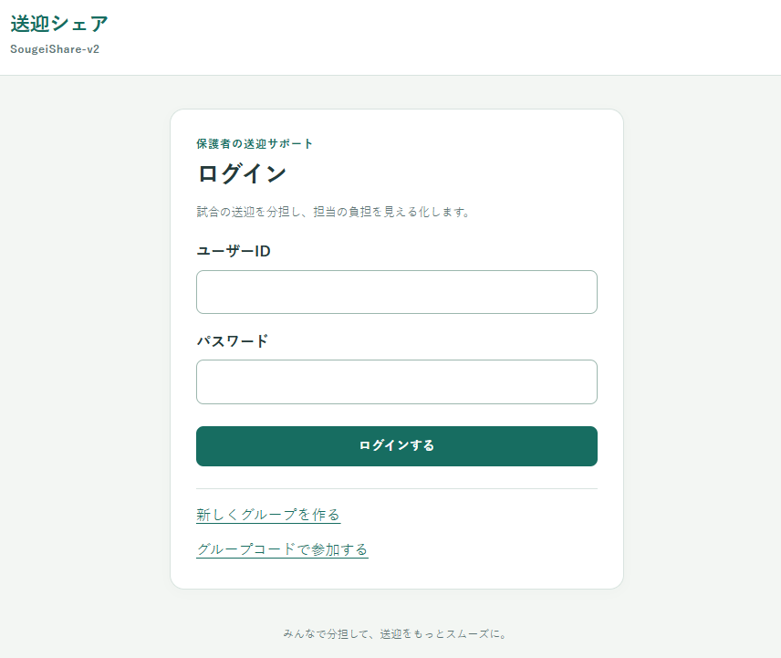
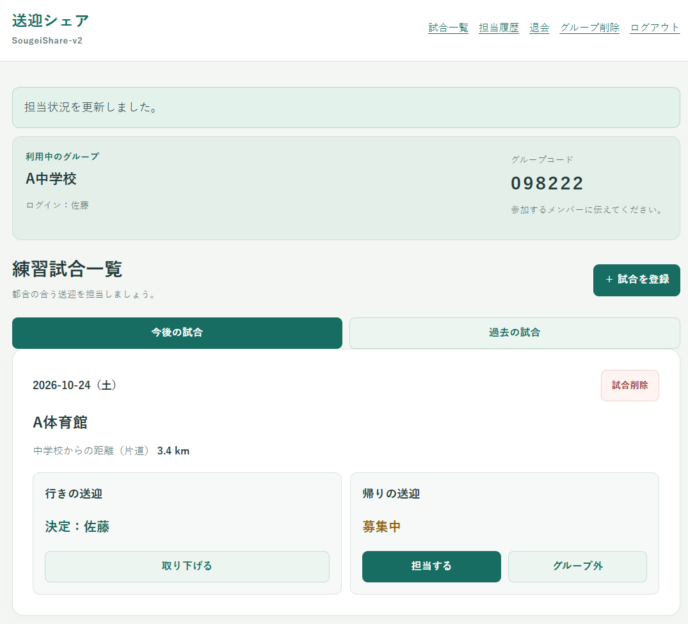
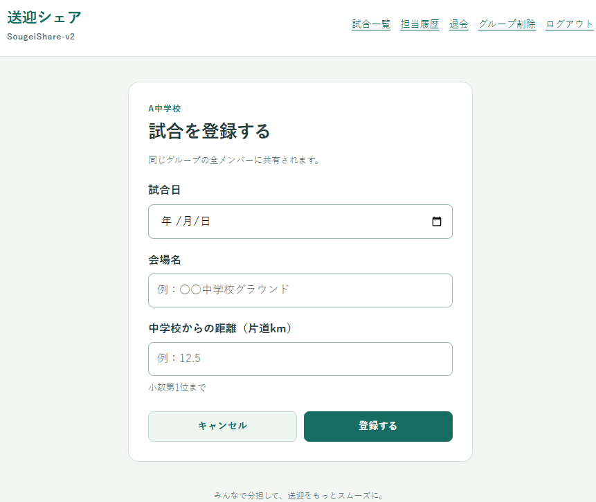
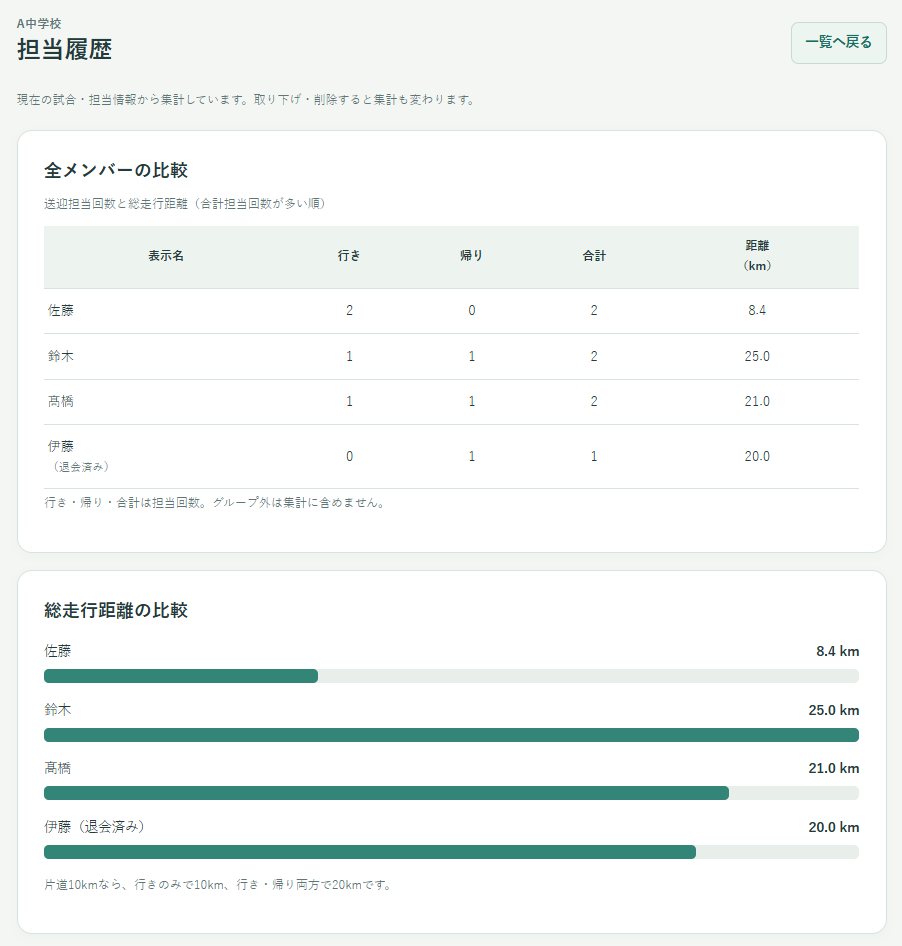
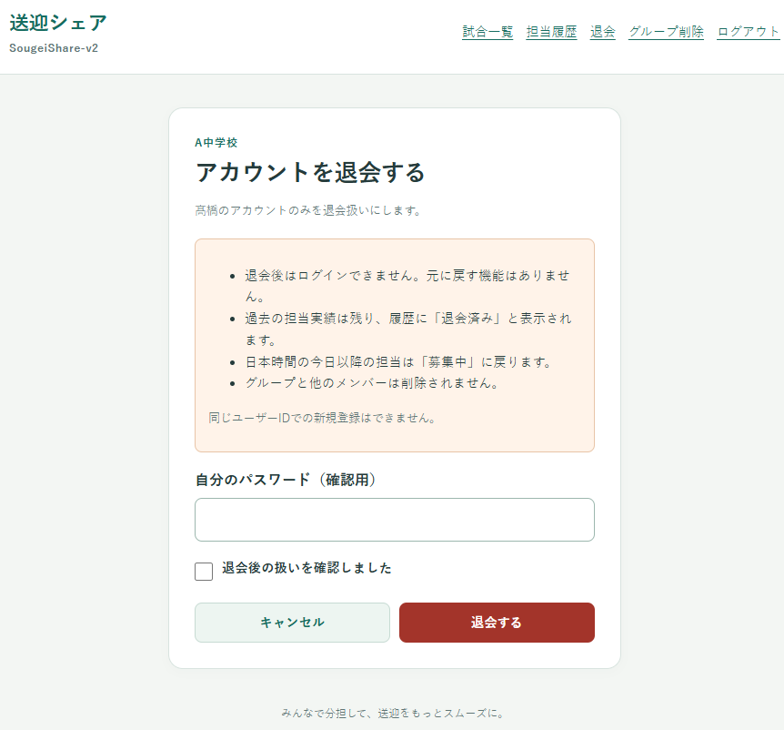
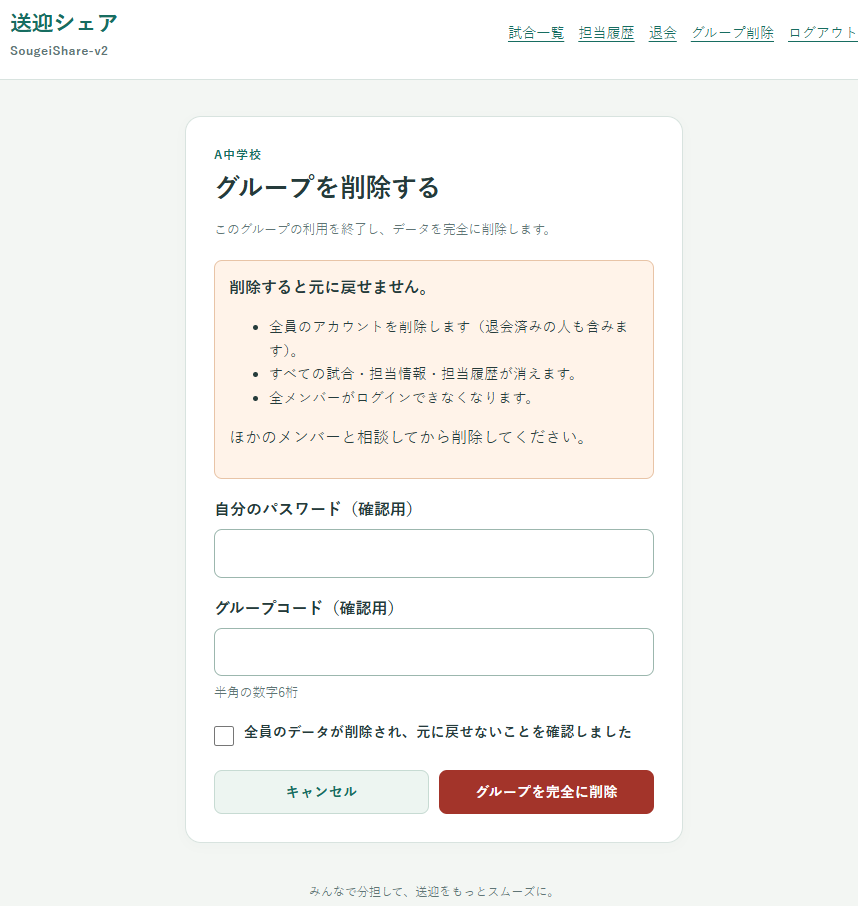
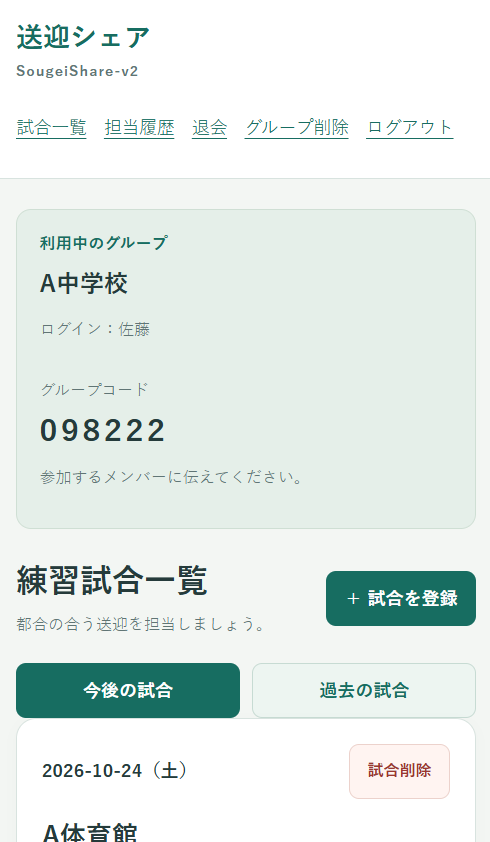

# SougeiShare-v2

**部活動の送迎分担・履歴管理Webアプリ**

[設計図をブラウザーで見る](design.html) ・ [Windowsでの起動方法](#6-起動方法windows-11)

ZIPを展開し、`SougeiShare-v2` フォルダを開きます。`README.html` はブラウザーで読めます。設計図は `design.html` または `docs/diagrams` 内の画像を開いてください。

## 1. アプリ概要

SougeiShare-v2は、部活動などの練習試合で発生する保護者の送迎担当を管理するWebアプリケーションです。

従来、グループ内で口頭やLINEなどを使って行っていた調整を、Webアプリ上で一元化することで、送迎の担当決めを簡単に行うことができます。また、過去の担当実績を可視化することで、保護者同士が協力しやすい仕組みを作りました。

### 管理できる内容

約4名の保護者で1つのグループを作成し、グループ内で交代で送迎を担当する状況を想定しています。

- 送迎担当者の管理
- 担当した回数の履歴
- 担当した総走行距離の履歴
- 練習試合ごとの送迎状況の履歴  


## 2. 主な機能

| 機能 | 内容 |
| --- | --- |
| ①ログイン | グループ作成、6桁のグループコードによる参加|
|          | ユーザーID・パスワードによる認証 |
| ②試合一覧 | 今後／過去の表示切替|
|　　　　　　| 一覧表示・削除 |
|　　　　　　| 送迎担当　行き・帰り別の担当登録と取り下げ |
| ③試合登録 | 試合の登録 |
| ④履歴管理 | 担当回数・総走行距離の集計、一覧表・横棒グラフでの比較 |
| ⑤アカウント退会 | 個人アカウントの退会 |
| ⑥グループ削除 | グループ全体の削除 |
| ⑦レスポンシブ | スマホ用画面 |


## 【画面イメージ】

<table>
  <tr>
    <th>①ログイン</th>
    <th>②試合一覧</th>
  </tr>
  <tr>
    <td><a href="image/image-1.png"></a></td>
    <td><a href="image/image-2.png"></a></td>
  </tr>
  <tr>
    <th>③試合登録</th>
    <th>④履歴管理</th>
  </tr>
  <tr>
    <td><a href="image/image-3.png"></a></td>
    <td><a href="image/image-4.png"></a></td>
  </tr>
  <tr>
    <th>⑤アカウント退会</th>
    <th>⑥グループ削除</th>
  </tr>
  <tr>
    <td><a href="image/image-5.png"></a></td>
    <td><a href="image/image-6.png"></a></td>
  </tr>
  <tr>
    <th>⑦レスポンシブ</th>
    <th></th>
  </tr>
  <tr>
    <td><a href="image/image-7.png"></a></td>
    <td></td>
  </tr>
</table>


## 3. 使用技術・システム構成

| 区分 | 技術 | 役割 |
| --- | --- | --- |
| バックエンド | Python / Flask | 画面遷移、ログイン、試合管理、履歴集計 |
| データベース | SQLite | ユーザー・グループ・試合情報の保存 |
| フロントエンド | HTML / CSS | 画面表示、入力フォーム、スマートフォン対応 |
| 開発環境 | Windows 11 / VS Code | 開発・動作確認 |

構成図は[アーキテクチャ図](docs/diagrams/02.png)を参照。


## 4. 工夫・改善した点

### スマートフォンでの操作性

旧版のカード形式を維持し、グループ情報の表示を追加しました。スマートフォン中心のレイアウトを採用しています。

### グループ単位での利用

複数の保護者グループが利用できるように、グループ作成・参加機能を追加しました。  
所属グループのデータだけを操作できる設計としています。

### 担当実績の可視化

送迎担当回数と総走行距離を集計し、メンバー間で比較できるようにしました。  
集計ルールは[確定仕様書3-4](docs/確定仕様書.md#3-4-担当履歴画面)を参照してください。


### 旧版からの改善点

| 項目 | 旧コードの実際 | v2の確定要件・対応 |
| --- | --- | --- |
| 試合一覧 | すでにカード形式 | カードを維持し、グループ名・コードを追加 |
| 担当取り下げ | 全ユーザーが可能 | 同グループ全員が可能 |
| グループ外の解除 | 「取り消す」で募集中へ戻る | 「募集中に戻す」で確認後に解除 |
| 距離集計 | 担当方向ごとに片道距離を加算 | 維持。往復換算しない |
| 履歴 | 全ユーザーの比較表、グラフなし | 同グループ全員の表＋CSS横棒グラフ |
| グループ | なし | groups追加、usersとmatchesにgroup_id追加 |
| パスワード | 平文で保存・照合 | ハッシュ保存・照合 |
| 初期データ | data.sqlからユーザー4人と試合2件 | seedと旧DBを引き継がず空のDBから開始 |
| 更新競合 | 試合IDだけで更新し、既存担当の上書きが可能 | 所属・現在状態を条件に含める |
| CSRF対策 | フォームに専用トークンなし | 全POSTで検証する |
| ログアウト | GETで状態変更 | CSRF付きPOSTのログアウトボタン |

## 5.生成AIの活用範囲

本アプリは、生成AI（ChatGPT）を開発支援ツールとして活用して制作しました。

| 工程 | 担当 | 内容 |
|---|---|---|
| 企画・発案 | 自分 | 日常の課題からアプリを発案 |
| 要件定義 | 自分・AI | 必要な機能や利用方法を検討 |
| 仕様設計 | 自分・AI | AIを活用しながら仕様を具体化 |
| 設計書作成 | AI | 設計図や構成資料を生成 |
| コーディング | AI | Python・Flask・SQLiteによる実装 |
| テスト | 自分・AI | AIによる確認支援、自分による動作確認 |
| 修正・改善 | 自分・AI | 改善点を指示し、AIがコードを修正 |
| 最終判断 | 自分 | 機能・仕様・デザインを最終決定 |

### 【自身の役割】

課題の発案から必要な機能の検討、仕様の決定、動作確認まで主体的に取り組みました。

実装には生成AIを活用し、生成されたコードについても理解を深めるために現在学習を進めています。

---


## 6. 起動方法（Windows 11）

Pythonをインストールし、`app.py` があるフォルダをVS Codeで開きます。ターミナル（PowerShell）で順番に実行します。

```powershell
py -m venv .venv
.\.venv\Scripts\python.exe -m pip install -r requirements.txt
.\.venv\Scripts\python.exe app.py
```

ブラウザで <http://127.0.0.1:5000> を開きます。初回起動でDBとローカル用秘密値を生成します。初期アカウントはないため、新規グループを作成します。停止はターミナルでCtrl+Cです。この起動方法は同じPCからのローカル利用用です。

## 7. 設計・検証資料

| 資料 | 役割・正本とする内容 |
| --- | --- |
| [確定仕様書](docs/確定仕様書.md) | 画面・業務ルール・入力規則・並び順 |
| [詳細設計](docs/詳細設計.md) | DB・SQL・認証・更新方式 |
| [設計図](design.html) | ブラウザーで読める設計図7点 |
| [設計図一覧](docs/設計図一式.md) | 閲覧用PNGと編集元Mermaidへのリンク |
| [フォルダ構成](docs/フォルダ構成.md) | ファイル配置 |
| [動作確認結果](docs/動作確認結果.md) | 確認主体・範囲・結果・未確認事項 |
